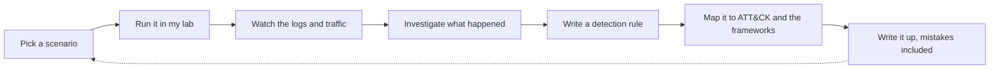
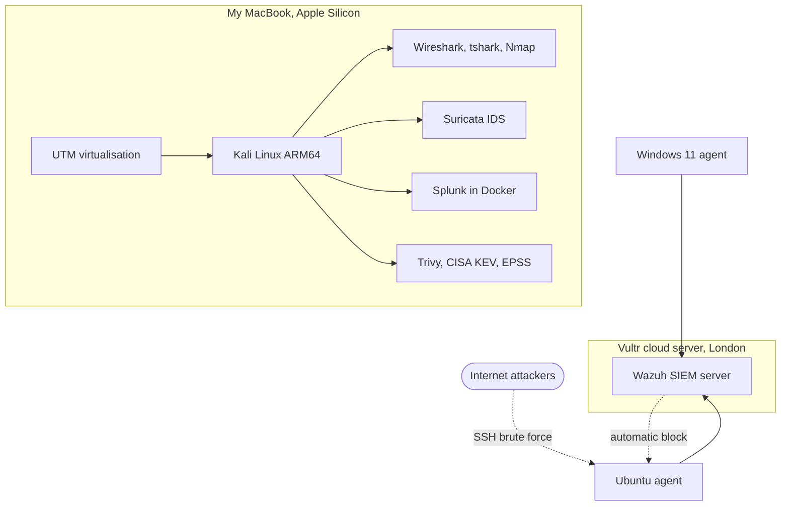
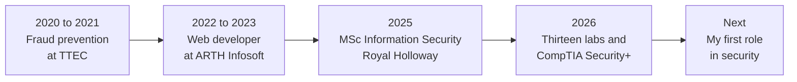

## Hello, I'm Bhargav

Welcome to my security portfolio. This is where I keep the labs, investigations and projects I've worked on while building towards my first role in information security.

I started out in fraud prevention, spending two years at TTEC spotting account takeovers and payment fraud in a busy alert queue. After that I worked as a web developer. I then completed an MSc in Information Security at Royal Holloway, University of London, and passed CompTIA Security+. Everything here comes from my own home lab and cloud servers, and I've written each piece up so that someone else could follow it and reach the same answer.

You'll find the mistakes in here too. When a rule fired on my own activity or a build broke, I wrote down why and what I changed, because that's usually where I learned the most.

## If you only have a minute

Three pieces give the best picture of how I work:

1. **[Wazuh SOC Lab](./projects/wazuh-soc-lab/)**: I built a SIEM on a bare cloud server, wrote my own detection rules and set up an automatic response that ended up blocking real brute-force attempts from the internet.
2. **[Case 001, Spearphishing in Seven Layers](./incidents/case-001/)**: one attack followed from the first email through to the command and control channel, mapped to MITRE ATT&CK, with the same detection written for three different tools.
3. **[OZONE Shield](https://github.com/Granger0007/ozone-shield)**: a free scam checker I built and still run. You paste in a suspicious message and it explains whether it looks like a scam and why.

## How I work on each lab

Every lab follows roughly the same loop. I set something up, watch what it leaves behind in the logs, and then write the detection that would catch it next time.

Each write-up covers the ATT&CK techniques I actually observed, and the containment and longer term fixes where the lab calls for them. For the investigations it also covers business impact, including UK GDPR reporting. In seven of the thirteen labs I wrote the same detection three ways, in Sigma, Splunk SPL and KQL, so it can be used whichever tool a team runs.

> **A note on scope.** Every scan, capture and test here was run against systems I own and built myself. Nothing was pointed at anyone else's systems. Under the Computer Misuse Act 1990 that line matters, and I keep to it.

## My home lab

My laptop is an Apple Silicon Mac with 8 GB of memory, and most security tools are built for Intel machines. So lighter work runs locally in a Kali Linux virtual machine, and anything heavy, like a SIEM, goes on a rented cloud server. I've documented each workaround so anyone else on an Apple Silicon Mac can do the same.

Setup guides: [Kali on UTM](./lab-setup/kali-utm/), [Wazuh on a cloud server](./lab-setup/wazuh-setup/), [Splunk on ARM64](./lab-setup/splunk-arm64/) and [Suricata](./lab-setup/suricata-ids/).

## The labs

There are three kinds of work here. **Labs** use real captures, scans and logs from my own machines, plus real phishing emails from a public honeypot collection. **Investigations** follow an attack from the first signal to containment. **Analysis** pieces look closely at one security topic without an incident attached.

| # | Type | Title | What it covers |
|:-:|------|-------|----------------|
| 001 | Investigation | [Spearphishing, A Story in Seven Layers](./incidents/case-001/) | Phishing to C2, T1566.001, T1204.002, T1059.005, Sigma, SPL and KQL |
| 002 | Investigation | [TCP Traffic Analysis, SSL Stripping and C2 Beacons](./incidents/case-002/) | T1040, T1071.001, T1557, Wireshark |
| 003 | Investigation | [Network Segmentation and Lateral Movement](./incidents/case-003/) | T1021.002, T1018, T1210, subnet boundaries |
| 004 | Lab | [DNS Enumeration](./lab-setup/dns-enumeration/) | dig, nslookup, DNS records, threat intelligence |
| 005 | Investigation | [HTTP vs HTTPS: Watching a Password Cross the Internet](./incidents/case-005/) | T1040, T1557.002, credential interception, TLS |
| 006 | Analysis | [Twenty Doors, Port Security](./incidents/case-006/) | Twenty common ports ranked by risk |
| 007 | Analysis | [Firewall Architecture](./incidents/case-007/) | Three-zone design, default deny |
| 008 | Lab | [Nmap Port Scanning](./lab-setup/nmap-labs/lab-008/) | Service detection, OS fingerprinting |
| 009 | Lab | [Wireshark Forensic PCAP Analysis](./lab-setup/wireshark-labs/lab-009/) | tshark, TCP flags, SSH banners |
| 010 | Lab | [Log Analysis Fundamentals](./lab-setup/log-analysis/lab-010/) | auth.log, Windows Event IDs 4624, 4625 and 4688 |
| 011 | Lab | [Phishing Email Triage: Four Domains, No Microsoft](./lab-setup/email-analysis/lab-011/) | SPF, DKIM, DMARC, header forensics, WHOIS |
| 012 | Investigation | [A Recruitment Scam That Targeted Me](./lab-setup/email-analysis/lab-012/) | DMARC alignment, domain age, reported to the NCSC |
| 013 | Lab | [Vulnerability Management: 121 Findings, 14 That Matter](./lab-setup/vuln-management/lab-013/) | Trivy, CVSS, EPSS, CISA KEV, ISO 27001 A.8.8 |

All thirteen are complete.

## MITRE ATT&CK coverage

These are the techniques I've observed and mapped across the labs so far, using ATT&CK v20.0. Version 19 split the old Defense Evasion tactic into Stealth and Defense Impairment, so you'll see both below.

| Tactic | Techniques |
|---|---|
| Reconnaissance (TA0043) | T1590.002, T1595.001, T1598, T1589.002, T1593.001 |
| Resource Development (TA0042) | T1584.004, T1583.001, T1585.002 |
| Initial Access (TA0001) | T1566.001, T1190, T1133, T1078 |
| Execution (TA0002) | T1204.002, T1059.005 |
| Stealth (TA0005) | T1027, T1036, T1684.001 |
| Defense Impairment (TA0112) | T1599 |
| Credential Access (TA0006) | T1110, T1040, T1557.002 |
| Discovery (TA0007) | T1046, T1018, T1040 |
| Lateral Movement (TA0008) | T1021.001, T1021.002, T1210 |
| Command and Control (TA0011) | T1071.001, T1071.004, T1573.001, T1571 |
| Exfiltration (TA0010) | T1041, T1048.003 |
| Impact (TA0040) | T1498.002 |

## Governance, risk and compliance

Detection tells you what happened. Governance asks whether it should have been possible in the first place, and how you'd prove the controls work. I want to be useful on both sides, so I've studied the frameworks properly.

| Framework | What I've covered | Where it shows up |
|---|---|---|
| ISO/IEC 27001:2022 | Clauses 4 to 10 and all 93 Annex A controls | Control mapping |
| NIST CSF 2.0 | All six functions, including Govern | Control mapping |
| Cyber Essentials v3.3 | The five technical controls | Control mapping |
| NCSC CAF v4.0 | Four objectives and fourteen principles | Public sector context |
| UK GDPR and DPA 2018 | Breach reporting, DPIAs and the 72 hour clock | Every investigation |
| NIST SP 800-61 Rev. 3 | The incident response lifecycle | Incident write-ups |

**Working on now:** mapping each part of my Wazuh and Entra ID lab to the ISO 27001, NIST CSF 2.0 and Cyber Essentials controls it supports, with the evidence an auditor would ask for and an honest list of the gaps.

**Next:** a data protection impact assessment for OZONE Shield, since it handles messages people paste in and some of those contain personal data.

## Projects

| Project | What it is | Built with | Status |
|---|---|---|---|
| [Wazuh SOC Lab](./projects/wazuh-soc-lab/) | A SIEM on a cloud server with Windows and Linux agents, file integrity monitoring, two custom detections and an automatic SSH block that stopped real attackers | Wazuh 4.14, Vultr, Ubuntu 24.04, Windows 11 ARM64 | Complete |
| [OZONE Shield](https://github.com/Granger0007/ozone-shield) | A free scam checker. Paste in a suspicious message and get a verdict, the reasons and what to do next | Claude API, Cloudflare Workers | Live |

## Skills

Everything below comes from my labs, projects and studies. I haven't held a security job yet, and that's exactly what I'm looking for.

| Area | Tools and skills |
|---|---|
| SIEM | Wazuh with custom rules, Splunk SPL, Elastic and KQL |
| Detection | Sigma, SPL and KQL rules, ATT&CK mapping, tuning out false positives |
| Incident response | NIST SP 800-61, building timelines, root cause, UK GDPR reporting |
| Governance | ISO 27001, NIST CSF 2.0, Cyber Essentials, NCSC CAF, UK GDPR, PCI DSS |
| Network analysis | Wireshark, tshark, tcpdump, Suricata, DNS, TLS |
| Identity | Microsoft Entra ID, MFA, Conditional Access, role-based access |
| Infrastructure | Kali Linux on ARM64, UTM, Docker, Vultr |
| Languages | Python, Bash, SQL, SPL, KQL |

## Qualifications

| Qualification | Where | Year |
|---|---|---|
| MSc Information Security | Royal Holloway, University of London, an NCSC-recognised Academic Centre of Excellence in Cyber Security Research | 2025 |
| CompTIA Security+ (SY0-701) | CompTIA | 2026 |

## Granger Security on YouTube

I've made over 230 videos and Shorts since 2022, mostly short explainers on AI security, security analysis and Python, with some longer CVE breakdowns and Security+ content. I make them for people changing career into security, because it's the kind of help I wish I'd had when I started.

## My journey so far

What I'm working on next: the control mapping and OZONE Shield DPIA above, and later on Microsoft SC-200, Splunk Core Certified User and cloud security.

## Get in touch

I'm looking for my first role in the UK, in IT support, as a SOC or information security analyst, or in security GRC. I'm happy to work anywhere in the UK and can start at short notice. I have full right to work in the UK, with no sponsorship needed to start.

The easiest way to reach me is a message on [LinkedIn](https://www.linkedin.com/in/bhargav-baranda).

*Everything here is free to use under the MIT License.*

