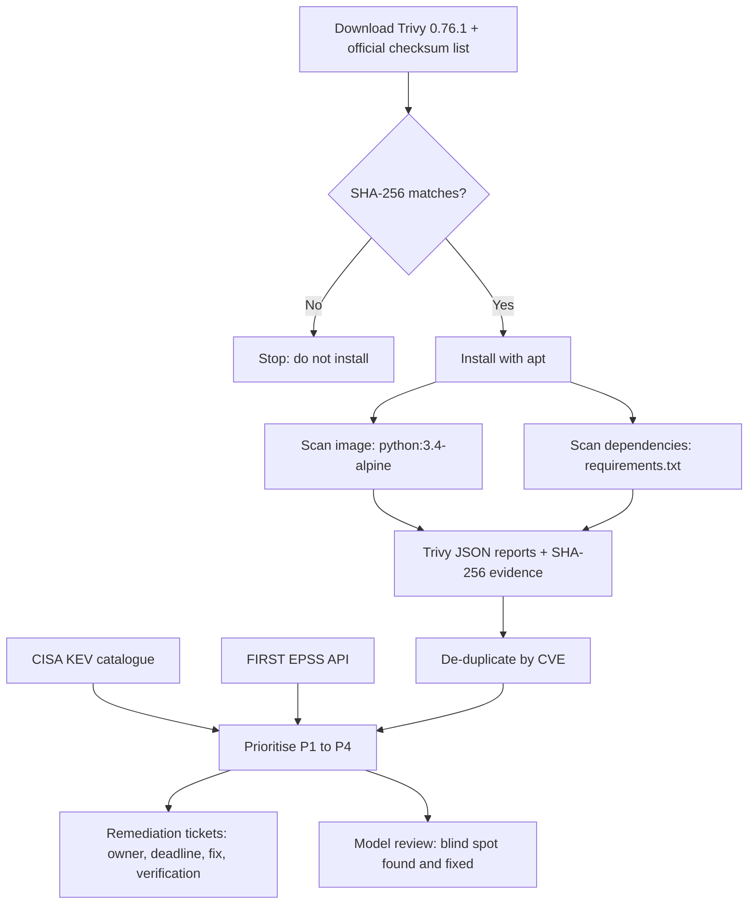
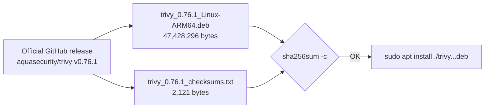
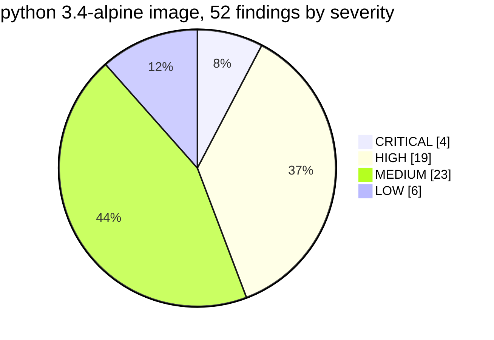
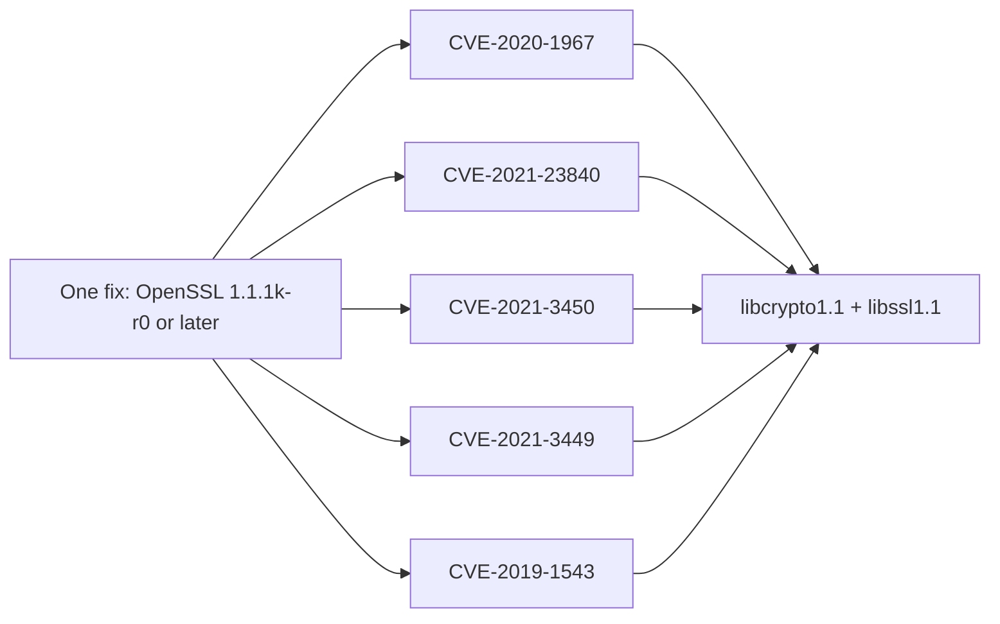
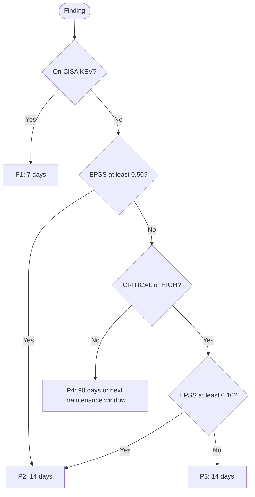
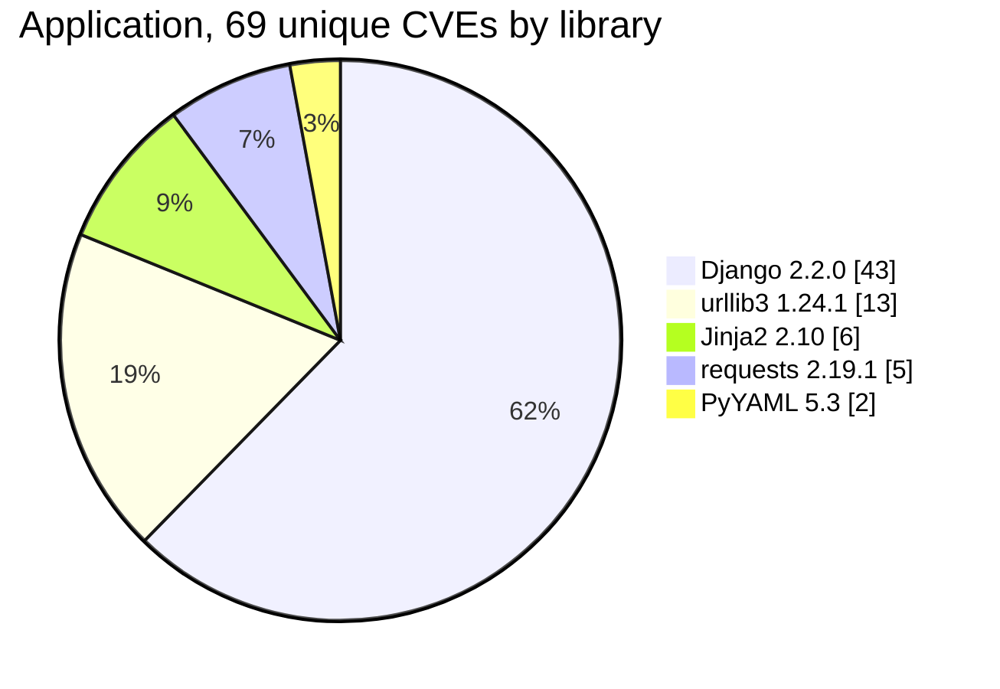
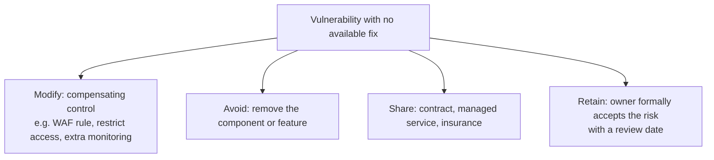

# Lab 013 — Vulnerability Management
## 121 Findings, 14 That Matter: Prioritising with CVSS, EPSS and CISA KEV

**Date:** 5 November 2026
**Author:** Bhargav (Granger) Baranda
**Environment:** Kali Linux ARM64 · UTM · MacBook Pro Apple Silicon
**Tools:** Trivy 0.76.1 · Python 3 · CISA KEV catalogue · FIRST EPSS API
**Targets:** `python:3.4-alpine` container image · an outdated Python dependency file
**Frameworks:** ISO/IEC 27001:2022 A.8.8 · NIST CSF 2.0 ID.RA-01 · Cyber Essentials v3.3 (Security update management)
**Security+ Objectives:** SY0-701 4.3 · 2.3
**Tier:** Tier 2 — Analyst Workflows
**Status:** ✅ Complete


## Executive Summary

Any scanner can produce a long list of CVEs. The analyst's job is deciding which handful to fix this week, and explaining why to the team that has to do the work.

I scanned two deliberately outdated targets: an end-of-life container image and a Python application with stale dependencies. Together they produced **121 findings**, which came down to **107 unique CVEs**. Sorting by CVSS alone would have put 23 image findings in the "high or critical" pile, with nothing to say which came first. So I prioritised them with three signals: **CISA's Known Exploited Vulnerabilities list**, **FIRST's EPSS** exploitation probability, and **CVSS** severity.

The result was **14 P2 items** to act on first (5 in the image, 9 in the application, both under the final version of my model), and two clear findings that changed the remediation plan:

- **A HIGH outranked a CRITICAL.** OpenSSL's CVE-2020-1967 (HIGH) had a **53% EPSS**. musl's CVE-2019-14697 (CRITICAL) had **2.5%**. CVSS-first ordering gets that backwards.
- **The real fix is replacement, not patching.** Both targets run on **end-of-life** software (Alpine 3.9, Python 3.4, Django 2.2), so the recommended fix is a rebuild or a supported major version, not dozens of individual patches.

I also found a **blind spot in my own prioritisation model**. Two medium-severity CVEs with very high EPSS scores (87% and 64%) were ranked last. I changed the rule and regression-tested the fix on both targets.

**Key findings:**
- Image: 52 findings → 38 unique CVEs → **5 P2** (4 of them fixed by one OpenSSL upgrade)
- Application: 69 unique CVEs → **9 P2** (all in Django 2.2.0, which is responsible for 43 of the 69)
- **0 on CISA KEV**, **0 without an available fix**
- The installer was verified by SHA-256 before installing it with root privileges


## Legal and Ethical Framework

Nothing in this lab touched a system I don't own. Trivy reads a container image's **layers as files** and compares package versions against a vulnerability database. **It never runs the image.** The second target is a five-line text file I wrote. No network scanning was involved. The only outbound calls were downloads (Trivy, its database, the image, the KEV catalogue) and an EPSS lookup that sends CVE IDs and nothing else.


## Workflow




## Environment and Evidence

```
OS:        Kali Linux ARM64 (UTM guest) — aarch64, 38 GB free
Scanner:   Trivy 0.76.1 (ARM64 .deb)
Trivy DB:  trivy-db v2, mirror.gcr.io, downloaded 2026-11-05 15:54 UTC (132 MiB)
KEV:       catalogue 2026.11.04, released 2026-11-04 20:00 UTC, 1,768 entries
           SHA256 273b7e449828f0af92e012bf03270a6a6c3deb21dc7a50b46ebe0447ea196bff
EPSS:      FIRST API, scores retrieved 2026-11-05
```

| Report | Size | SHA-256 |
|---|---|---|
| `python34.json` (image, all severities) | 454,196 bytes | `5abc466d2c87e5551c3979ab42813d6f515e16e065f9b11909878f3cee10e0d9` |
| `app.json` (dependencies) | 331,476 bytes | `6f0d870940697a084b8e5119e3bacc514c90ab7c3def3bc464f0f6899fecc266` |

A report hash identifies **that specific report**. Running the same scan again produces a different hash, because the JSON includes a timestamp. The point is traceability: every ticket below cites the exact report it came from.


## 1. Supply-Chain Check Before Installing



```bash
sha256sum --ignore-missing -c trivy_0.76.1_checksums.txt
```
```
trivy_0.76.1_Linux-ARM64.deb: OK
```

I was about to give this software root privileges, so it had to be verified first. A matching size proves nothing: a malicious file can be padded to the same length. A matching cryptographic hash does.

**The limitation, stated honestly:** the checksum file comes from the same release page as the installer. This proves **integrity** (nothing changed in transit or storage), but an attacker in control of the release could replace both files. Signature verification (Trivy publishes Cosign signatures) would add **authenticity**. That's the next step up.

Two smaller details from the install:
- `Download size: 0 B` confirmed apt used the verified local file, not a fresh download.
- `Download is performed unsandboxed as root` appeared because apt's low-privilege `_apt` user can't read inside my home directory. That's harmless for a verified local file. Copying the `.deb` to `/tmp` first keeps the sandbox on.


## 2. Target One: the Container Image

```bash
trivy image --severity CRITICAL,HIGH python:3.4-alpine | tee python34_high.txt
trivy image --format json --output python34.json python:3.4-alpine
```

The headline wasn't a CVE. It was this:

```
WARN  This OS version is no longer supported by the distribution  family="alpine" version="3.9.2"
WARN  The vulnerability detection may be insufficient because security updates are not provided
```

Alpine 3.9 is end of life, so **the real exposure is larger than the scan shows**: vulnerabilities found after support ended aren't tracked for this version. Under Cyber Essentials, unsupported software in scope is a failure in its own right.

### Severity distribution (all 52 findings)



### Rows are not vulnerabilities



OpenSSL is packaged as two libraries (`libcrypto1.1` and `libssl1.1`), so each of its CVEs appears twice in the table. `musl` and `musl-utils` share one CVE the same way. The image had **52 rows but 38 unique CVEs**, and **one OpenSSL upgrade clears 5 CVEs (10 rows)**. Remediation is planned **by package**, not by CVE.


## 3. Prioritisation: Three Signals

| Signal | Question | Scale | Limitation |
|---|---|---|---|
| **CVSS** | How bad could it be? | 0–10 | Measures impact, not likelihood |
| **EPSS** (FIRST) | How likely is exploitation activity in the next 30 days? | 0–1 | A prediction, not proof |
| **CISA KEV** | Is it being exploited now? | Yes / No | Confirmed cases only: 1,768 entries against roughly 300,000 published CVEs |

### The priority model (version 2)

These are rules I set for the lab, not an official standard.



P1 to P3 all sit inside **Cyber Essentials' 14-day window** for high and critical fixes. The model doesn't replace that rule. It decides the **order of work** within it. The middle "EPSS at least 0.50" step was added in version 2 (see section 6).

The script is in this folder: [`prioritise.py`](./prioritise.py). It de-duplicates findings by CVE, looks up EPSS in batches of 50, applies the rules above, and carries on with a warning if the EPSS lookup fails.

### Image results (model v2)

```
Unique vulnerabilities: 38 | P1: 0 | P2: 5 | P3: 14 | P4: 19
P2   CVE-2021-3449     MEDIUM     0.635   libcrypto1.1 1.1.1a-r1, libssl1.1 1.1.1a-r1
P2   CVE-2020-1967     HIGH       0.533   libcrypto1.1 1.1.1a-r1, libssl1.1 1.1.1a-r1
P2   CVE-2021-23840    HIGH       0.507   libcrypto1.1 1.1.1a-r1, libssl1.1 1.1.1a-r1
P2   CVE-2019-8457     CRITICAL   0.454   sqlite-libs 3.26.0-r3
P2   CVE-2021-3450     HIGH       0.183   libcrypto1.1 1.1.1a-r1, libssl1.1 1.1.1a-r1
...
P3   CVE-2019-14697    CRITICAL   0.025   musl 1.1.20-r4, musl-utils 1.1.20-r4
```

### CVSS and EPSS disagree

| CVE | Package | CVSS severity | EPSS | Priority |
|---|---|---|---|---|
| CVE-2020-1967 | OpenSSL | HIGH | **0.533** | **P2** |
| CVE-2019-14697 | musl | **CRITICAL** | 0.025 | P3 |

A team working from CVSS alone fixes the musl CRITICAL first. On EPSS, the OpenSSL HIGH is about **20 times more likely** to see exploitation activity. EPSS is an internet-wide statistical estimate, not a statement about this specific system, but as a way to order work it's far better than severity alone.


## 4. Target Two: Application Dependencies

Vulnerable libraries are where a lot of real exposure sits. This is software composition analysis.

```text
Django==2.2.0
requests==2.19.1
urllib3==1.24.1
PyYAML==5.3
Jinja2==2.10
```

```bash
trivy fs --format json --output ../app.json .
python3 -I scripts/prioritise.py scans/app.json data/kev.json --all
```

**Nothing was installed.** Trivy read the names and versions from the file.

### Where the vulnerabilities sit



```
Unique vulnerabilities: 69 | P1: 0 | P2: 8 | P3: 25 | P4: 36     (model v1)
P2   CVE-2020-7471     CRITICAL   0.656   Django 2.2.0
P2   CVE-2019-19844    CRITICAL   0.536   Django 2.2.0
P2   CVE-2022-23833    HIGH       0.495   Django 2.2.0
...
```

Django 2.2.0 carries **43 of the 69 CVEs (62%)** and **every P2**. One upgrade removes most of the risk. But Django 2.2 reached end of life with its final release, **2.2.28, on 11 April 2022**, so there's no patch-level fix for the later CVEs. The minimum fix is already a major-version upgrade, and a major-version upgrade breaks code. The ticket has to say that.

**A scan limitation worth knowing:** for a plain `requirements.txt`, Trivy checks only the packages listed. In a real project these five would pull in transitive dependencies of their own, which wouldn't be scanned here. A lock file, or scanning the installed environment, gives fuller coverage.


## 5. No Fix Available?

```bash
# count findings with an empty FixedVersion, across both reports
scans/python34.json | rows: 52 | with no fix: 0
scans/app.json      | rows: 69 | with no fix: 0
```

I checked the full JSON rather than the filtered priority list, because the list hides P4 by default. Every finding had a fix, which fits: both targets are old, and the fixes have long since been published. Unfixed vulnerabilities are a feature of current software. When there's no fix, the ticket still needs a decision:



The analyst recommends. **The system owner decides**, and any acceptance comes with a review date.


## 6. Model Review: Finding My Own Blind Spot

Version 1 of the model only escalated **CRITICAL and HIGH** findings on EPSS. That produced this:

```
P4   CVE-2019-11358   MEDIUM   0.868   Django 2.2.0
```

The **highest EPSS in the entire dataset (87%)** was ranked **last**. I only noticed it in the application, because the image's P4 findings were hidden by default. Re-running the image under the fixed model showed the same pattern there. CVE-2019-11358 is a jQuery prototype pollution flaw. It appears under Django because Django bundles jQuery for its admin interface, and its EPSS is high because jQuery is everywhere. Whether it matters for a given application depends on whether the admin site is exposed. Either way, it shouldn't sit at the bottom of the list.

**The fix:** anything with EPSS ≥ 0.50 is at least P2, regardless of severity.

```diff
     if f["cve"] in kev:
         return "P1"
+    if epss.get(f["cve"], 0) >= 0.50:
+        return "P2"
     high = f["severity"] in ("CRITICAL", "HIGH")
```

**The regression check:** I kept a copy of version 1, applied the change through a script that refuses to edit unless the target text appears exactly once, and re-ran it:

| Target | Model | P1 | P2 | P3 | P4 | Total |
|---|---|---|---|---|---|---|
| Application | v1 | 0 | 8 | 25 | 36 | 69 |
| Application | v2 | 0 | **9** | 25 | **35** | 69 |
| Image | v1 | 0 | 4 | 14 | 20 | 38 |
| Image | v2 | 0 | **5** | 14 | **19** | 38 |

The intended change happened, and nothing else moved. Exactly one finding was escalated in each target:

| Target | CVE | Severity | EPSS | v1 | v2 |
|---|---|---|---|---|---|
| Application | CVE-2019-11358 (jQuery prototype pollution, bundled in Django) | MEDIUM | 0.868 | P4 | **P2** |
| Image | CVE-2021-3449 (OpenSSL renegotiation denial of service) | MEDIUM | 0.635 | P4 | **P2** |

In the image, the escalated CVE now has the **highest EPSS of any finding**, above every HIGH and CRITICAL. The model change is the main lesson of this lab: **a prioritisation model is a tool, and tools need testing against real data.**


## 7. Remediation Tickets

```text
Ticket:        VULN-013-001
Priority:      P2                         Due: 19 November 2026 (14 days)
Asset:         python:3.4-alpine container image
Owner:         Platform / container team
Finding:       OpenSSL 1.1.1a-r1 — 4 P2 vulnerabilities with elevated exploitation likelihood:
               - CVE-2021-3449  (MEDIUM, EPSS 0.635) Denial of service via crafted renegotiation
               - CVE-2020-1967  (HIGH,   EPSS 0.533) Denial of service in SSL_check_chain
               - CVE-2021-23840 (HIGH,   EPSS 0.507) Integer overflow in CipherUpdate
               - CVE-2021-3450  (HIGH,   EPSS 0.183) CA certificate check bypass
Packages:      libcrypto1.1 1.1.1a-r1, libssl1.1 1.1.1a-r1
Evidence:      Trivy 0.76.1, 2026-11-05 16:06 UTC, python34.json SHA256 5abc466d…e10e0d9
               Prioritised against CISA KEV 2026.11.04 and FIRST EPSS (2026-11-05)
Why P2:        Not on CISA KEV, but three CVEs have EPSS above 0.50 — FIRST estimates over 50% probability
               of exploitation activity in the next 30 days. Highest-likelihood findings in this image.
               CVE-2021-3449 is MEDIUM severity but has the highest EPSS (escalated by model v2).
Fix (minimum): Upgrade OpenSSL to 1.1.1k-r0 or later (also closes CVE-2019-1543, P3).
Fix (preferred): Rebuild on a currently supported Python/Alpine base image. Alpine 3.9 and
               Python 3.4 are end of life; patching inside them leaves untracked vulnerabilities.
               Removes all 38 CVEs in this image.
Verification:  Re-scan the rebuilt image with Trivy; confirm the CVEs above are absent;
               attach the new report and its SHA256 to this ticket.
Compliance:    High-severity fix — within Cyber Essentials' 14-day window.
```

```text
Ticket:        VULN-013-002
Priority:      P2                         Due: 19 November 2026 (14 days)
Asset:         Lab web application (Python) — dependencies declared in requirements.txt
Owner:         Application / development team
Finding:       Django 2.2.0 — 9 P2 vulnerabilities (model v2); top three by exploitation likelihood:
               - CVE-2020-7471  (CRITICAL, EPSS 0.656) SQL injection via StringAgg delimiter
               - CVE-2019-19844 (CRITICAL, EPSS 0.536) Account takeover via password reset email
               - CVE-2022-23833 (HIGH,     EPSS 0.495) Denial of service in file upload parsing
               Django 2.2.0 accounts for 43 of the 69 CVEs in this application.
Packages:      Django 2.2.0
Evidence:      Trivy 0.76.1 fs scan, 2026-11-05 16:37 UTC, app.json SHA256 6f0d8709…fecc266
               Prioritised against CISA KEV 2026.11.04 and FIRST EPSS (2026-11-05)
Why P2:        None on CISA KEV, but three findings have EPSS of 0.49 or above — FIRST estimates roughly
               50–66% probability of exploitation activity in the next 30 days. Two are CRITICAL.
Fix:           Upgrade Django to a currently supported release. Django 2.2 reached end of life
               (final release 2.2.28, 11 April 2022), so there is no patch-level option.
Change risk:   Major-version upgrade will break code. Requires regression testing in a
               non-production environment and a change request before deployment.
Verification:  Update requirements.txt, re-run `trivy fs`, confirm the Django CVEs are absent;
               attach the new report and its SHA256 to this ticket.
Note:          CVE-2019-11358 (MEDIUM, EPSS 0.868) — jQuery prototype pollution in Django's bundled
               admin assets. Escalated to P2 by model v2. Resolved by the same upgrade.
Compliance:    Critical/high fixes — within Cyber Essentials' 14-day window.
```

The two tickets are fixed differently. An **image** is fixed by **rebuilding** it, and it belongs to the platform team. A **library** is fixed by **changing the dependency version and testing the code**, and it belongs to the application team. Sending a ticket to the wrong owner is one of the most common ways remediation stalls.


## Framework Mapping

| Framework | Reference | How this lab addresses it |
|---|---|---|
| ISO/IEC 27001:2022 | **A.8.8** Management of technical vulnerabilities | Identify, evaluate and remediate vulnerabilities in a timely, risk-based way |
| ISO/IEC 27001:2022 | **A.5.21** Managing information security in the ICT supply chain | SHA-256 verification of the scanner before installation |
| ISO/IEC 27001:2022 | **A.8.32** Change management | Major-version upgrade routed through testing and a change request |
| NIST CSF 2.0 | **ID.RA-01** Vulnerabilities in assets are identified, validated, and recorded | Scans, de-duplication, evidence hashes, tickets |
| Cyber Essentials v3.3 | Security update management | High and critical fixes (CVSS ≥ 7) within 14 days; unsupported software flagged |

**MITRE ATT&CK context:** unpatched, internet-facing software is what **T1190 Exploit Public-Facing Application** relies on. Vulnerability management is the main preventive control against it.


## What Went Wrong

- **My prioritisation model had a blind spot.** Restricting EPSS escalation to high and critical findings ranked the most likely-to-be-exploited CVE in each target last. Fixed in version 2 and regression-tested on both targets (section 6).
- **I nearly published a number I hadn't checked.** I'd only re-run the application under model v2. Re-running the image as well changed its P2 count from 4 to 5. Never assume a change affects only the data you looked at.
- **I misread the table on the first pass.** In the image scan I recorded 13 as the total (13 was the HIGH count; the total was 17) and gave the wrong fixed version for a CVE by reading the row above it. In a ticket, a wrong fixed version sends a team to a release that's still vulnerable. Merged table cells make this easy to do, which is one reason to work from JSON.
- **My first ticket drafts were vague.** "Fix: yes" and "Verification: don't know" aren't actionable. A ticket a non-security engineer can't act on without coming back to you isn't finished.
- **Copying the first ticket as a template carried errors into the second.** It said "this image" and assigned the platform team, for what was an application dependency. Re-read every field against the new finding.
- **I nearly called the image a library problem, and vice versa.** "Rebuild the Django base image" mixes up two different fixes. Images are rebuilt; libraries are upgraded and tested.
- **Not everything here is complete.** A `requirements.txt` scan misses transitive dependencies, and an end-of-life OS hides vulnerabilities that are no longer tracked. Both are in the write-up because a scan is only as complete as what it can see.


## Interview Answer

> "In my lab I scanned an end-of-life container image and an outdated Python application with Trivy, then prioritised the findings instead of just sorting by CVSS. I used CISA's Known Exploited Vulnerabilities list first, then FIRST's EPSS for exploitation likelihood. One HIGH OpenSSL issue had a 53% EPSS while a CRITICAL in musl had 2.5%, so the HIGH went first. I wrote remediation tickets with owners, deadlines and verification by re-scan, and recommended rebuilding on a supported base rather than patching inside an end-of-life OS. Then I found a blind spot in my own model: medium-severity issues with EPSS scores of 87% and 64% were ranked last. So I added an escalation rule and regression-tested it on both targets."

---

## Files in This Folder

| File | Purpose |
|---|---|
| [`prioritise.py`](./prioritise.py) | Prioritisation script, model v2 (2,588 bytes) |
| [`requirements.txt`](./requirements.txt) | The outdated dependency file used as target two |

The Trivy JSON reports aren't included. They're regenerated by running the commands above, and they'd produce new hashes on every run.
